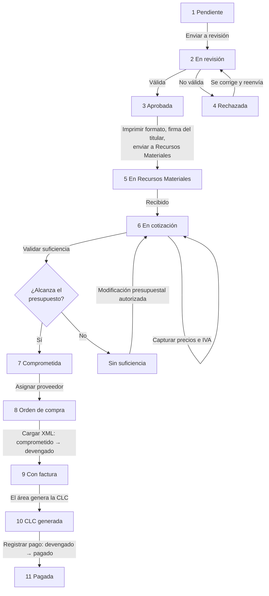

# Módulos

Menú lateral: **Panel**, **Presupuesto**, **Ejercicio y control del gasto**, **Requisiciones** (listado, nueva, Recursos Materiales, proveedores, modificaciones presupuestales), **Catálogos**, **Secretarías y direcciones** y **Administración**. Cada entrada aparece solo con su permiso (ver [Permisos](permisos.md)).

## Panel

`/dashboard` — Resumen del presupuesto de las unidades del usuario (asignado, modificado, vigente, en trámite, comprometido, devengado, pagado, disponible) y lo pendiente en cada etapa: requisiciones por enviar, en revisión, en Recursos Materiales, con suficiencia sin orden de compra y modificaciones por autorizar. Cada tarjeta lleva a su listado.

---

## Presupuesto

`/presupuesto` (solo Admin) — Presupuesto de egresos importado desde Excel a la tabla `presupuesto 2024`. Cada **línea** es una combinación **unidad administrativa + fuente de financiamiento + proyecto + partida**, con su importe anual y mensual (DECIMAL con centavos).

- **Nueva partida** (`/presupuesto/crear`, permiso `presupuesto-create`): se eligen secretaría o dirección, fuente, proyecto y partida **de los catálogos**; los nombres, el capítulo y el tipo de gasto se toman de ahí. No se puede repetir la combinación de las cuatro claves.
- **Distribución mensual: ni de más ni de menos.** Al dar de alta, editar o importar, los 12 meses deben sumar **exactamente** el importe total (al centavo). La pantalla muestra en vivo lo distribuido y lo que falta o sobra, ofrece *Repartir en 12 meses iguales* y no deja guardar hasta que cuadre; el servidor lo vuelve a validar. Al **importar**, si el archivo trae *Importe total* y algún renglón no cuadra, **no se importa nada** y el mensaje lista los renglones (si no trae la columna, el total es la suma de los meses).
- Las líneas anteriores que no cuadran (redondeos de cuando los importes se guardaban sin centavos) se marcan en la lista con lo que falta o sobra y se pueden filtrar con *Solo distribución que no cuadra*; al editarlas hay que corregir la distribución.

`PresupuestoService` calcula para cada línea:

| Saldo | Cálculo |
|---|---|
| Asignado | Importe importado |
| Modificado | Suma de modificaciones presupuestales **autorizadas** (+ destino, − origen) |
| Vigente | Asignado ± modificado |
| Comprometido | Requisiciones **con suficiencia** cuya orden de compra aún no tiene factura |
| En trámite | Requisiciones cotizadas que aún no tienen suficiencia |
| Devengado | Requisiciones cuya orden de compra ya tiene **factura XML** (bien o servicio recibido y facturado) y aún no se paga |
| Pagado | Requisiciones cuya orden de compra ya tiene **pago registrado** |
| Disponible | Vigente − comprometido − devengado − pagado |

**Saldos mensuales y corrida de saldos.** Además del disponible anual, cada línea tiene un **disponible del mes** = saldo corrido + asignado del mes (calendario) ± modificaciones autorizadas en el mes − comprometido en el mes (por fecha de suficiencia). El **día 1 de cada mes** se *corren los saldos*: lo que quedó disponible en el mes anterior se suma al mes actual como **saldo corrido** (si se excedió, se resta). Se guarda en `saldos_mensuales` sin tocar el calendario autorizado y queda congelado (un movimiento tardío de un mes ya corrido no cambia lo corrido). Enero empieza en cero. Corre sola por el scheduler; también hay botón *Correr saldos* (permiso `presupuesto-correr-saldos`) y el comando `presupuesto:correr-saldos`. Una sola corrida por mes (el comando la puede recalcular con `--forzar`).

Cada importe está en **un solo momento**: al cargar la factura pasa de comprometido a devengado y al registrar el pago, de devengado a pagado (el disponible no cambia). En la validación de suficiencia, la columna *Comprometido* es todo lo ya ejercido de la línea. La lista de `/presupuesto` muestra por línea la **clave del proyecto** (con filtro) y los importes **comprometido, devengado y pagado**.

Las modificaciones se guardan por clave de línea (no por id), así que sobreviven a una re-importación del presupuesto.

`/requisiciones/gasto` ("Ejercicio y control del gasto") muestra estos saldos por línea de las unidades del usuario (asignado, modificado, vigente, comprometido, en trámite, devengado, pagado y disponible), con filtro por unidad, búsqueda y opción de ver solo partidas con movimiento. La tabla muestra 20 partidas por página (los totales son de todas) y se puede desplazar de lado arrastrándola con el mouse. **Exportar a Excel** descarga todo lo que cumple los filtros, no solo la página (mismos filtros y búsqueda), con totales por fórmula e importes como números.

## Requisiciones

`/requisiciones` — Cada usuario ve solo las requisiciones de **su secretaría o dirección** (se asigna en Administración → Usuarios). Admin ve todas.

- Captura: fecha de trámite, unidad administrativa, concepto y renglones con **Partida / Proyecto / Fuente** (tres columnas encadenadas: cada una solo ofrece valores que combinan con lo ya elegido y que tienen disponible), cantidad y descripción. Al guardar se valida que cada renglón exista en el presupuesto de la unidad.
- Folio: prefijo de la secretaría o dirección + consecutivo anual (`REQ-0001` si no tiene prefijo).
- **Calendario de captura**: el periodo ordinario es del día 1 al 7 de cada mes, configurable por ejercicio en `/catalogos/ejercicios` (*Captura de requisiciones: del día / al día*). La pantalla de captura avisa si el periodo está abierto. Lo que se captura fuera del periodo queda **extemporáneo**: no se puede *Enviar a revisión* hasta que la Subdirección Administrativa (Adquisiciones, permiso `requisiciones-extemporaneas`) pulsa *Autorizar extemporánea*; se guarda quién y cuándo (`extemporanea_user_id`, `extemporanea_autorizada_at`) y queda en la bitácora. La lista marca *Extemporánea por autorizar / autorizada*.
- El monto total siempre es la suma de los conceptos.

Los estados 7 a 11 se agregaron al catálogo `cat_egreso_requisicion_estado` (migración `2026_10_12_100000`, que además pasó a su estado las requisiciones que ya tenían suficiencia y seguían "En cotización").

**Cuándo se puede editar:** en Pendiente y Rechazada; en cotización solo los precios y el IVA, hasta que tenga suficiencia. En revisión, aprobada y en Recursos Materiales no se puede modificar (también se bloquea en el servidor). El formato FUR se imprime desde que es válida.

## Recursos Materiales

`/recursos-materiales` — Bandeja de todas las secretarías con requisiciones de Recursos Materiales en adelante (en cotización, comprometida, orden de compra, con factura, CLC generada, pagada).

1. **Recibido**: inicia la cotización.
2. **Editar cotización**: precio unitario por concepto y si **lleva IVA** (16 %).
3. **Validar suficiencia presupuestal**: compara lo cotizado contra el disponible de cada línea. Un mensaje muestra el resultado por partida (requerido, disponible, faltante) y la requisición queda **Con suficiencia** o **Sin suficiencia**. Si se cambian los precios después, hay que volver a validar.
4. **Sin suficiencia**: el botón *Solicitar modificación presupuestal* abre la solicitud con la partida que no alcanza y el importe faltante ya llenos.
5. **Con suficiencia**: la requisición pasa a **Comprometida** (ya no aparece "En cotización") y se habilita *Asignar proveedor y generar orden de compra*.

## Órdenes de compra y facturas

- Solo para requisiciones **Comprometidas**. Se asigna el **proveedor** (`/catalogos/proveedores`, catálogo con RFC) o, si no está, se da de alta ahí mismo (nombre y RFC; requiere `proveedores-create`), la fecha y observaciones. Folio `OC-AÑO-0001`; el importe es el total de la requisición. PDF imprimible. La requisición pasa a **Orden de Compra**.
- **Cargar factura (XML CFDI 3.3/4.0)**: se rechaza si
  - el total del CFDI no coincide con lo cotizado (tolerancia de 1 centavo),
  - el RFC del emisor no es el del proveedor de la orden,
  - el XML no está timbrado (sin UUID) o el UUID ya se cargó en otra orden.
- El XML se guarda en el disco privado (`storage/app/private/ordenes-compra/`) y se puede descargar. Con la factura cargada ("factura aceptada"), la requisición pasa a **Con Factura** y el importe sale de comprometido y pasa a **devengado**.
- **CLC (cuenta por liquidar certificada)**: con la factura aceptada, el **área** de la requisición (permiso `requisiciones-clc`; Admin y Recursos Materiales también) genera la CLC: folio `CLC-AÑO-0001`, una por orden. Su PDF trae beneficiario, RFC, cuenta bancaria del proveedor (la del catálogo de proveedores; si no tiene, la principal de sus cuentas adicionales), factura y UUID, el importe por clave presupuestal y firmas (tipo de documento `clc` en Firmantes). La requisición pasa a **CLC Generada**.
- **Registrar pago** (permiso `ordenes-compra-pagar`, solo con la CLC generada y una sola vez): fecha (no anterior a la orden ni futura), forma (transferencia o cheque) y referencia. El importe pasa de devengado a **pagado**, la requisición queda **Pagada** y queda en la bitácora.

## Modificaciones presupuestales

`/modificaciones-presupuestales`

| Tipo | Efecto |
|---|---|
| Traspaso | Quita de una línea (origen) y da a otra (destino) |
| Reducción | Solo disminuye una línea (p. ej. no se alcanzó la meta de la Ley de Ingresos) |
| Ampliación | Solo aumenta una línea |

1. El área registra la solicitud (folio `MP-AÑO-0001`): la línea **emisora** (origen) y la **receptora** (destino), el **periodo** (mes) de cada una —del mes actual a diciembre—, importe y justificación. El emisor no puede quedar en negativo ni en el año ni en el mes elegido (el formulario muestra el disponible del mes y cómo queda).
2. Se imprime el formato para firma.
3. El **Jefe de Control Presupuestal** (permiso `modificaciones-autorizar`) la **acepta** o la **rechaza** (con motivo obligatorio), desde el detalle o directo en la lista (botones *Aceptar* / *Rechazar* en las pendientes). Al aceptar se vuelve a revisar el disponible del emisor (anual y del mes) y el presupuesto vigente cambia de inmediato. En los saldos mensuales el movimiento cuenta en el periodo de cada lado (las modificaciones anteriores, sin periodo, en el mes en que se autorizaron).
4. El listado es el **historial**, con filtros por folio, tipo, estado y partida; muestra el periodo junto al emisor y al receptor.

Las áreas solo ven y usan líneas de sus unidades; quien autoriza ve todas.

---

## Catálogos generales

`/catalogos` — Portada con los catálogos que el usuario puede ver, por grupo. Cada catálogo (`/catalogos/{slug}`) tiene la misma pantalla:

- **Altas y modificaciones** en un diálogo; la validación (obligatorios, únicos, formatos) es la misma al capturar y al importar.
- **Bajas lógicas**: *Dar de baja* deja el registro inactivo y se puede *Reactivar*. Nada se borra, porque hay documentos que los referencian.
- **Historial** de cada registro: quién, cuándo y qué cambió (valor anterior → nuevo).
- **Importación masiva** desde Excel o CSV: se descarga la plantilla (con una hoja de instrucciones), se sube y se ve una **vista previa** con altas, modificaciones, sin cambios y errores por renglón. No se guarda nada hasta confirmar, y no se puede confirmar si algún renglón tiene errores. Si el registro ya existe (por su llave, p. ej. la clave o el número económico) se actualiza, y las celdas vacías no borran el valor actual.

| Grupo | Catálogo (`slug`) | Notas |
|---|---|---|
| Estructura orgánica | Secretarías y direcciones (`unidades-administrativas`) | Un solo catálogo: dependencias y centros gestores (`cat_egreso_unidad_administrativa`); prefijo de folio, titular y cuántos usuarios tiene. Llave: clave + año |
| | Departamentos (`departamentos`) | Dentro de cada dirección |
| | Responsables y firmantes (`firmantes`) | Por tipo de documento y rol (elabora, revisa, autoriza, visto bueno), con vigencia. Uno con dirección tiene prioridad sobre el general |
| Clasificación presupuestal | Objeto del Gasto (`objeto-gasto`) | Partida específica; capítulo, concepto y genérica se derivan de la clave (CONAC). Tipo de gasto |
| | Fuentes de financiamiento, Programas, Proyectos | Claves de `CLAVE3` y `CLAVE6` del presupuesto |
| Ejercicios y documentos | Ejercicios fiscales (`ejercicios`) | Abierto / cerrado: un ejercicio **cerrado** bloquea requisiciones nuevas de ese año |
| | Tipos de documento (`tipos-documento`) | `requisicion`, `orden_compra` y `modificacion_presupuestal` los usan los PDF para buscar firmantes |
| Proveedores y bancos | Proveedores (`proveedores`) | RFC validado; banco, CLABE (con dígito verificador, única) y número de cuenta; permisos `proveedores-*` |
| | Cuentas bancarias (`cuentas-bancarias`) | CLABE con dígito verificador; el banco se toma de sus 3 primeros dígitos; una sola cuenta principal por proveedor |
| | Bancos (`bancos`) | `cat_banco` con clave de 3 dígitos |
| Padrón vehicular | Vehículos (`vehiculos`) | Número económico, placas, serie, secretaría o dirección asignada, resguardante. Los cambios de resguardante quedan en el historial |

**Firmantes en los PDF.** La requisición (*Autorizó*), la orden de compra (*Elaboró*, *Autorizó*) y la modificación presupuestal (*Procede / No procede*) imprimen nombre y cargo del firmante vigente en la fecha del documento; sin firmante configurado conservan el texto anterior.

**Carga inicial.** `php artisan catalogos:inicializar` agrega a fuentes, proyectos y partidas las claves que ya usa el presupuesto importado, la lista de bancos y el ejercicio fiscal actual. Solo agrega lo que falta (`--pretend` muestra cuántos). Al importar el presupuesto, el mensaje avisa qué claves no están en los catálogos.

---

## Administración

- `/auditoria` — **Bitácora de auditoría** de todo el sistema: altas, modificaciones, bajas, reactivaciones y eliminaciones de requisiciones (y sus conceptos), órdenes de compra, modificaciones presupuestales, presupuesto, catálogos, secretarías, usuarios (incluidos cambios de rol y de contraseña, sin guardar la contraseña), roles y sus permisos y tickets; además los **accesos**: inicio y cierre de sesión e intentos fallidos con el correo usado. Cada movimiento lleva usuario, IP, fecha y valores anterior/nuevo. Filtros por módulo, usuario, acción y fechas; el nombre del módulo lleva al registro, *Registro #* muestra todo lo de ese registro y la descripción del lote muestra toda una importación o borrado masivo.
- `/settings/users` — Usuarios: rol y **secretaría o dirección** (una sola; define qué requisiciones y presupuesto ve).
- `/settings/roles`, `/settings/permissions` — Roles y permisos (ver [Permisos](permisos.md)).
- `/support-tickets` — Tickets de soporte con comentarios y notificaciones.
- `/logs` — Visor del log de Laravel.
